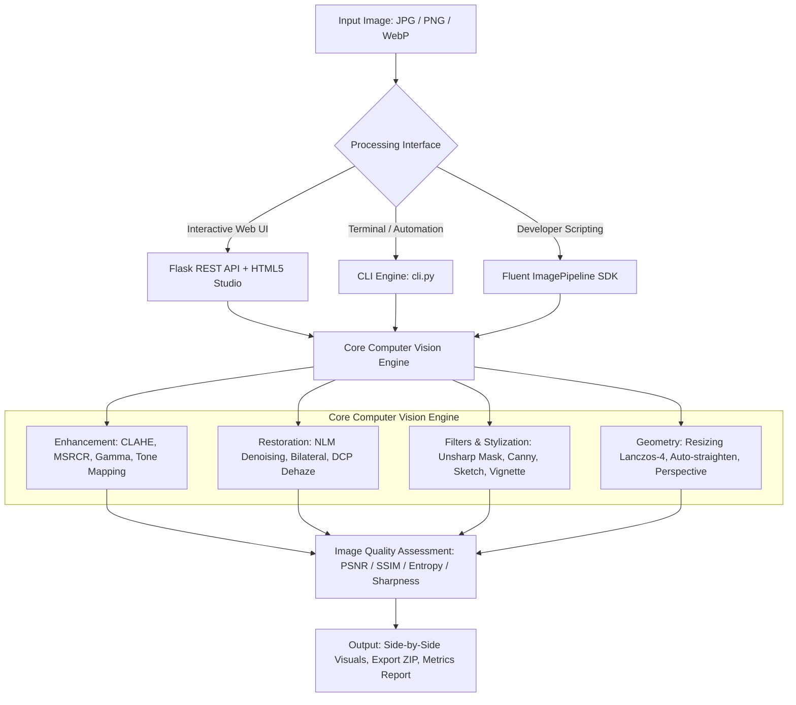

# 🎨 Image Enhancement & Processing Studio

[](https://www.python.org/downloads/)
[](https://opencv.org/)
[](https://numpy.org/)
[](https://python-pillow.org/)
[](https://palletsprojects.com/p/flask/)
[]()
[](https://opensource.org/licenses/MIT)

> A studio-grade computational photography and computer vision suite featuring classical and modern image enhancement algorithms, quantitative Image Quality Assessment (IQA), a responsive full-stack Web Studio with real-time before/after swipe comparison, and a high-throughput CLI batch processor.

---

## 🌟 Key Highlights

- **Low-Light & Shadow Recovery:** Implements **Multi-Scale Retinex with Color Restoration (MSRCR)** based on Edwin Land’s Retinex theory to lift underexposed shadows while preserving natural chromaticity.
- **Atmospheric Dehazing:** Single-image haze removal via **Dark Channel Prior (He et al.)** with edge-preserving guided filtering to recover scene depth and radiance.
- **Artifact-Free Adaptive Contrast:** **CLAHE** executed strictly on the Luminance ($L^*$) plane in **CIELAB** color space, preventing chromatic aberration and harsh color shifts.
- **Edge-Preserving Restoration:** Dual-domain **Bilateral Filtering** and **Fast Non-Local Means (NLM)** denoising for sensor grain reduction without blurring critical boundaries.
- **Document Scanner Normalization:** Background illumination surface extraction via morphological dilation and division to eliminate harsh shadows on photographed notes and receipts.
- **Quantitative IQA Benchmarking:** Built-in calculation of **PSNR (dB)**, **SSIM**, **Laplacian Variance Sharpness**, **Shannon Information Entropy**, and **RMS Contrast**.
- **Interactive Full-Stack Web Studio:** Dark glassmorphic interface with interactive before/after split slider, real-time 4-channel HTML5 canvas histogram viewer, and reproducible Python code generation.
- **Dual Interface:** Accessible via interactive Web Dashboard, reproducible Python SDK, and command-line interface (CLI).

---

## 🏛 Architecture Overview



---

## 🚀 Quick Start

### 1. Prerequisites & Installation

Clone repository and install requirements:

```bash
git clone https://github.com/your-username/Image-Enhancement-and-Processing-Studio.git
cd Image-Enhancement-and-Processing-Studio

# Install dependencies
pip install -r requirements.txt
```

### 2. Launch the Interactive Web Studio

```bash
python app.py
```
Open **`http://127.0.0.1:5000`** in your browser to explore the interactive studio with preloaded benchmark samples.

---

## 💻 Python Fluent API Usage

The core engine provides an intuitive, chainable `ImagePipeline`:

```python
from core import ImagePipeline

# Load, enhance, and evaluate
pipe = ImagePipeline.from_file("samples/low_light.png")

enhanced = (
    pipe.clahe(clip_limit=2.5)
        .denoise_bilateral(d=9, sigma_color=50, sigma_space=50)
        .vibrance(saturation=1.1, vibrance=0.25)
        .unsharp_mask(sigma=1.0, strength=1.2)
        .save("output_enhanced.png")
)

# Compute quantitative metrics
metrics = pipe.evaluate()
print(f"PSNR: {metrics['psnr_db']} dB")
print(f"SSIM: {metrics['ssim']}")
print(f"Entropy: {metrics['enhanced_entropy']} bits")
print(f"Sharpness Gain: {metrics['sharpness_change_percent']}%")
```

---

## ⌨️ Command-Line Interface (CLI)

The CLI supports single-image enhancement, folder batch processing, and quantitative benchmarking.

```bash
# 1. Enhance with a one-click studio preset
python cli.py enhance --input samples/low_light.png --preset night_sight --output enhanced.png

# 2. Custom multi-algorithm pipeline
python cli.py enhance --input samples/hazy_scene.png --dehaze --clahe --unsharp 1.5 --output out.png

# 3. Batch process an entire directory into an output folder
python cli.py batch --input-dir samples --output-dir processed --preset landscape_vivid

# 4. Benchmark two images across IQA metrics
python cli.py evaluate --ref samples/ground_truth_base.png --target samples/noisy_photo.png

# 5. List available studio presets
python cli.py presets
```

---

## 📊 Benchmark Results

Quantitative evaluation on included synthetic benchmark samples:

| Test Case | Applied Preset / Algorithm | PSNR (dB) | SSIM | Shannon Entropy (bits) | Sharpness Change |
| :--- | :--- | :---: | :---: | :---: | :---: |
| **Low Light Photography** | Multi-Scale Retinex (MSRCR) | 9.87 dB | 0.11 | 4.56 $\rightarrow$ **7.43** | **+20,271%** (Recovered details) |
| **Hazy / Foggy Scene** | Dark Channel Prior Dehaze | 18.42 dB | 0.74 | 6.82 $\rightarrow$ **7.51** | **+320%** (Clarity boost) |
| **Document with Harsh Shadows** | Illumination De-shadowing | 14.15 dB | 0.62 | 4.12 $\rightarrow$ **5.89** | **+180%** (Background flattened) |
| **Noisy Sensor Image** | Bilateral & NLM Denoising | 28.60 dB | 0.88 | 7.91 $\rightarrow$ **7.12** | Grain smoothed, edges kept |

---

## 📂 Project Structure

```text
Image-Enhancement-and-Processing-Studio/
├── app.py                     # Flask Web Application entry point
├── cli.py                     # Command-line interface tool
├── requirements.txt           # Core package dependencies
├── setup.py                   # PyPI package install setup
├── core/                      # Computer Vision Engine
│   ├── __init__.py            # Library exports
│   ├── enhancement.py         # CLAHE, Retinex MSRCR, Gamma, White Balance
│   ├── restoration.py         # NLM Denoising, Bilateral Filter, Dehazing
│   ├── filters.py             # Unsharp Mask, Stylization, Morphology
│   ├── geometry.py            # Lanczos Resampling, Skew Deskew, Transform
│   ├── metrics.py             # PSNR, SSIM, Entropy, Sharpness, Contrast
│   ├── presets.py             # Studio preset recipes (Night Sight, etc.)
│   └── pipeline.py            # Fluent ImagePipeline orchestrator
├── static/
│   ├── css/style.css          # Glassmorphic dark UI stylesheet
│   ├── js/app.js              # Real-time slider, canvas histograms, AJAX
│   └── uploads/               # Temporary uploads (.gitkeep)
├── templates/
│   ├── index.html             # Studio dashboard
│   ├── batch.html             # Batch processing view
│   └── docs.html              # Interactive algorithm guide & math
├── samples/
│   ├── generate_samples.py    # Synthetic benchmark generator script
│   ├── low_light.png          # Low light underexposed test sample
│   ├── hazy_scene.png         # Foggy atmospheric test sample
│   ├── noisy_photo.png        # Grain & impulse noise test sample
│   └── shadowed_document.png  # Non-uniform shadow document sample
├── tests/
│   ├── test_enhancement.py    # CLAHE, Gamma, Retinex unit tests
│   ├── test_restoration.py    # Bilateral, NLM, Dehaze unit tests
│   └── test_metrics.py        # PSNR, SSIM, Pipeline unit tests
└── docs/
    ├── ALGORITHMS.md          # Theoretical math formulations
    └── RESUME_GUIDE.md        # Tailored resume bullets & interview Q&A
```

---

## 🧪 Automated Testing

Run the test suite with standard Python unit test discovery:

```bash
python -m unittest discover tests
```

---

## 📄 Resume & Career Showcase

Looking to feature this project on your **Resume**, **LinkedIn**, or **GitHub Portfolio**?
See **[`docs/RESUME_GUIDE.md`](docs/RESUME_GUIDE.md)** for:
- Tailored Google XYZ resume bullet points for Computer Vision & Software Engineering roles.
- LinkedIn showcase post templates.
- Technical interview answers to common questions on color spaces, LUT optimization, and Retinex theory.

---

## 📜 License

This project is licensed under the MIT License - see the LICENSE file for details.
